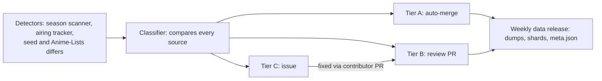

# Courmap: Anime Episode Resolution Spec

Build spec for Claude Code. Last updated 2026-10-18. Owner: Xwolv (GitHub org `courmap`).

## Goals and non-goals

The service answers one question every anime tool keeps reinventing: given an episode in one provider's numbering (or a raw release name), what is that episode in every other provider's numbering? ID-level mapping is consumed from existing datasets, not rebuilt.

**Goals**

- Translate an episode between AniDB, AniList, MAL, Kitsu, TVDB, TMDB, IMDB and absolute numbering, including split cours, specials and long-runners.
- Resolve a release name to a canonical work and episode, with a confidence score and the competing candidates.
- Keep all mapping data as reviewable YAML in a public repo, corrected through pull requests.
- Ship weekly data dumps (SQLite + JSON), static JSON shards and client libraries, so nothing depends on a running server.

**Non-goals**

- Not a metadata provider: no synopses, images, staff or ratings. Clients fetch those from the source providers.
- No mirroring or redistribution of AniDB data. Only derived mappings are stored.
- Not a PVR, indexer or scraper. It never touches release sites.
- Never guesses silently: an ambiguous answer is returned as ambiguous, with candidates.

## Core concepts

Every provider maps to one canonical hub, never to each other. With 8 providers, pairwise edges would mean 28 mapping sets to keep consistent; hub-and-spoke means 8, and any translation is two hops: provider A to the hub, hub to provider B.

| Concept | What it is | Example |
| --- | --- | --- |
| Work | The canonical unit, at the finest grain any provider uses: usually one cour, film or OVA. Matches AniDB/AniList granularity. | Season 2 Part 2 of a show is its own work |
| Canonical episode | A work's own numbering: regular episodes 1..N, specials S1..Sn, plus credits, trailers and parodies as separate kinds. | `work:frieren / ep:12`, `work:frieren / S1` |
| Provider ref | A work's ID in one provider, optionally scoped. Format `provider:id[:scope]`. | `anilist:12345`, `tvdb_show:67890:s2` |
| Projection | How a provider lays a work's episodes out: which season and which numbers a range of canonical episodes lands on. | Canonical 1-12 = TVDB season 1, episodes 13-24 |
| Absolute sequence | An ordered chain of works numbered continuously, the way fansubs number long series. | Cour 1 eps 1-25 = abs 1-25, cour 2 eps 1-12 = abs 26-37 |
| Group override | A release group's known numbering quirk for a work. | Group X numbers cour 2 as 13-24 |

The `provider:id[:scope]` format is Courmap's own. It resembles the descriptors of anibridge-mappings (both write season scopes as `s{n}`) but is not compatible with them: anibridge scopes AniDB refs by episode type (`anidb:1:S`), splits IMDb into `imdb_movie` and `imdb_show`, always requires a season scope on show providers, and has no Kitsu. Exchanging data with anibridge needs a small adapter.

## Mapping file format

One YAML file per hand-written work under `works/`, one per absolute sequence under `sequences/`, one per release group under `groups/`. A file is the unit of review: one PR fixes one show. Seeded works live in sharded JSONL under `seeds/` instead (see "Seeds and manual files"), and a YAML file overrides its seed line part by part. All IDs below are placeholders.

**Simple case: one cour, one season everywhere**

```yaml
id: frieren
type: tv            # tv | movie | ova | ona | special
year: 2023
episodes: 28
specials: 0
titles:
  romaji: Sousou no Frieren
  english: "Frieren: Beyond Journey's End"
  native: 葬送のフリーレン
ids:
  anidb: 10001
  anilist: 20001
  mal: 30001
  kitsu: 40001
  tvdb_show: 50001
  tmdb_show: 60001
projections:
  tvdb_show:
    - { season: 1, episodes: 1-28 }
  tmdb_show:
    - { season: 1, episodes: 1-28 }
aliases:
  - Frieren
  - Frieren Beyond Journeys End
```

**Split cour: AniDB/AniList split it, TVDB merges it into one season**

```yaml
id: example-show-part-2
type: tv
episodes: 12
ids:
  anidb: 10002
  anilist: 20002
  tvdb_show: 50002
projections:
  tvdb_show:
    - { season: 1, episodes: 1-12, start: 13 }   # canonical 1-12 -> S01E13-E24
  tmdb_show:
    - { season: 2, episodes: 1-12 }              # TMDB treats it as its own season
prequel: example-show-part-1
```

**Specials and double-length episodes**

```yaml
projections:
  tvdb_show:
    - { season: 1, episodes: 1-11 }
    - { kind: special, episodes: S1-S2, season: 0, start: 5 }  # S1, S2 -> S00E05, E06
    - { episodes: 12, season: 1, target: 12-13 }               # one canonical ep = two TVDB eps
```

**Long-runner with an open-ended range**

```yaml
id: example-long-runner
status: airing
episodes: null        # unknown while airing
projections:
  tvdb_show:
    - { season: 1, episodes: 1-61 }
    - { season: 2, episodes: 62-77, start: 1 }
    - { season: 21, episodes: 892-, start: 1 }   # open-ended: grows as episodes air
```

**Absolute sequence: how fansubs number a multi-cour show**

```yaml
# sequences/example-show.yaml
id: example-show-absolute
members:
  - { work: example-show-part-1, episodes: 1-25, absolute_start: 1 }
  - { work: example-show-part-2, episodes: 1-12, absolute_start: 26 }
```

A work may belong to several sequences (for example a fansub numbering and a streaming service's numbering). When it does, exactly one of its memberships is marked `default: true`, and the `absolute` translate target answers in that sequence:

```yaml
# sequences/example-show-streaming.yaml
id: example-show-streaming
members:
  - { work: example-show-part-2, episodes: 1-12, absolute_start: 1 }
# and in example-show-absolute above:
#   - { work: example-show-part-2, episodes: 1-12, absolute_start: 26, default: true }
```

**Group override: one group's known quirk**

```yaml
# groups/examplesubs.yaml
id: examplesubs
aliases: [ExampleSubs, ExSubs]
overrides:
  - { work: example-show-part-2, numbering: continue_prequel }   # releases 2-cour as 13-24
  - { work: example-show-part-2, numbering: absolute, sequence: example-show-streaming }  # or: numbers by a non-default sequence
```

**Partial coverage: a provider that stops early**

```yaml
projections:
  tmdb_show:
    coverage: partial
    notes: TMDB lists only the first 10 episodes so far
    ranges:
      - { season: 1, episodes: 1-10 }
```

A provider block is either a plain list of ranges or, when its coverage needs explaining, an object with `ranges`. `coverage: partial` lets the ranges stop before the work's last episode and requires `notes` giving the reason. Without it, a mapping that stops early on a finished work is an error. Holes at the start or in the middle are marked `gap: true` on the range that follows them.

Rules: `start` defaults to the first canonical number in the range; `target` is only for N-to-M episode splits; ranges in one projection never overlap; every file carries an optional `notes:` field and a `sources:` list of URLs justifying non-obvious mappings.

## Compiled data model

The YAML compiles into one SQLite file per data release. That file is the offline dump, the input to the static shard generator, and what `createOfflineClient` reads; nothing writes to it after the build.

```sql
CREATE TABLE meta (
  key   TEXT PRIMARY KEY,          -- data_version, git_sha, built_at, schema_version
  value TEXT NOT NULL
);

CREATE TABLE works (
  id            TEXT PRIMARY KEY,  -- slug, stable forever once published
  type          TEXT NOT NULL,     -- tv | movie | ova | ona | special
  status        TEXT,              -- finished | airing | upcoming
  year          INTEGER,
  episodes      INTEGER,           -- NULL while unknown
  specials      INTEGER,           -- NULL = unknown
  title_romaji  TEXT, title_english TEXT, title_native TEXT,
  prequel_id    TEXT REFERENCES works(id),
  prequel_origin TEXT              -- manual | bot (AniList relation) | derived (from TVDB order); NULL when no prequel
);

CREATE TABLE provider_refs (
  work_id      TEXT NOT NULL REFERENCES works(id),
  provider     TEXT NOT NULL,      -- anidb | anilist | mal | kitsu | tvdb_show | tmdb_show | tmdb_movie | imdb
  provider_id  TEXT NOT NULL,
  origin       TEXT NOT NULL,      -- manual | bot | offline-db | anime-lists
  PRIMARY KEY (provider, provider_id, work_id)
);
CREATE INDEX idx_refs_work ON provider_refs(work_id);

CREATE TABLE projections (
  work_id      TEXT NOT NULL REFERENCES works(id),
  provider     TEXT NOT NULL,
  kind         TEXT NOT NULL DEFAULT 'regular',  -- regular | special | credit | trailer | parody
  ep_from      INTEGER NOT NULL,   -- canonical range start
  ep_to        INTEGER,            -- NULL = open-ended
  season       INTEGER,            -- NULL for providers without seasons
  target_from  INTEGER NOT NULL,   -- first provider episode number
  target_to    INTEGER,            -- set only for N-to-M splits
  origin       TEXT NOT NULL
);
CREATE INDEX idx_proj_lookup ON projections(provider, work_id, kind, ep_from);
CREATE INDEX idx_proj_reverse ON projections(provider, season, target_from);
CREATE INDEX idx_proj_work ON projections(work_id, provider, kind, ep_from);  -- one work's rows (lookup)

CREATE TABLE sequences (
  id      TEXT PRIMARY KEY,
  origin  TEXT NOT NULL
);
CREATE TABLE sequence_members (
  sequence_id     TEXT NOT NULL REFERENCES sequences(id),
  work_id         TEXT NOT NULL REFERENCES works(id),
  ep_from         INTEGER NOT NULL,
  ep_to           INTEGER,
  absolute_start  INTEGER NOT NULL,
  is_default      INTEGER NOT NULL,  -- 1 for the work's default sequence
  origin          TEXT NOT NULL,
  PRIMARY KEY (sequence_id, work_id, ep_from)
);
CREATE INDEX idx_members_work ON sequence_members(work_id);

CREATE TABLE aliases (
  work_id     TEXT NOT NULL REFERENCES works(id),
  alias       TEXT NOT NULL,       -- as written
  normalized  TEXT NOT NULL,       -- lowercased, punctuation and macrons folded
  origin      TEXT NOT NULL
);
CREATE INDEX idx_alias_norm ON aliases(normalized);
CREATE INDEX idx_alias_work ON aliases(work_id);

CREATE TABLE groups (
  id      TEXT PRIMARY KEY,
  origin  TEXT NOT NULL
);
CREATE TABLE group_aliases (
  group_id TEXT NOT NULL REFERENCES groups(id),
  alias    TEXT NOT NULL,
  origin   TEXT NOT NULL
);
CREATE TABLE group_overrides (
  group_id   TEXT NOT NULL REFERENCES groups(id),
  work_id    TEXT NOT NULL REFERENCES works(id),
  numbering  TEXT NOT NULL,        -- continue_prequel | absolute | offset
  offset     INTEGER,
  sequence_id TEXT REFERENCES sequences(id),  -- numbering: absolute with a non-default sequence
  origin     TEXT NOT NULL
);
```

The `origin` column on every derived row, in every table except `meta` and `works`, records which seed dataset or manual file it came from, so a bad import can be traced and rolled back by source. A work's own row has no origin because a merged work can draw its fields from several sources; each of its refs, projections and aliases carries its own.

## API spec

The API is a client library contract first and an HTTP surface second. The same operations exist in the TypeScript library, any future ports, and, optionally, the Worker; all return the JSON shapes below and carry `data_version`.

| Operation | Library call | Optional Worker endpoint | Data it reads |
| --- | --- | --- | --- |
| Lookup | `lookup(ref): Promise<Work>` | `GET /v1/lookup?ref=anilist:20002` | `refs/{provider}/{shard}.json` then `works/{id}.json` |
| Translate | `translate(ref, episode, targets): Promise<TranslateResult>` | `GET /v1/translate?from=anilist:20002&episode=5&to=tvdb_show,absolute`; `POST` batch up to 500 | Work file, plus its sequence file for `absolute` |
| Resolve | `resolve(releaseName): Promise<ResolveResult>` | `GET /v1/resolve?release=...`; `POST` batch up to 100 | `aliases/<prefix>.json` (and `aliases/grams/` for fuzzy matching), then work, sequence and group files |
| Search | `search(query): Promise<WorkSummary[]>` | `GET /v1/search?q=frieren` | `aliases/<prefix>.json`, `aliases/grams/` |
| Meta | `meta(): Promise<Meta>` | static `/v1/meta.json` | `meta.json` |

Library modes: `createRemoteClient(baseUrl)` (default `https://data.courmap.com/v1/`) fetches shards on demand, cached by `data_version` in memory and, in Node, optionally on disk; `createOfflineClient(dumpPath)` reads the SQLite dump with no network at all. Results must be identical across modes, enforced by a shared conformance test suite in CI (`tests/conformance/`).

**Refs**

| Ref | Meaning | Episode argument |
| --- | --- | --- |
| `anidb:ID`, `anilist:ID`, `mal:ID`, `kitsu:ID` | Canonical providers: their numbering is the work's own | Canonical number. Only `anidb` takes specials and other kinds (`"S1"`, `"C2"`) |
| `tvdb_show:ID:sN`, `tmdb_show:ID:sN` | Season-based providers. The `:sN` scope is required (`:s0` for specials), unless the work has a seasonless projection, which is addressed with no scope | Provider episode number in that season, reversed through the projection |
| `tmdb_movie:ID`, `imdb:ttID` | Id-only providers: they identify a work but have no episode numbering | Read as canonical |
| `work:SLUG` | The canonical hub itself | Canonical number or kind-prefixed (`"S1"`) |
| `absolute:SEQUENCE` | An absolute sequence (translate source only) | Absolute number |

Episodes may be passed as numbers or strings (`5`, `"5"`, `"S1"`). A scope on a provider without seasons, or a missing scope on a seasonal ref, is `invalid_input`.

**Lookup** returns the work's full record (`works/{id}.json`) plus `data_version`: ids (every ID as a string), projections ordered by provider, kind and `ep_from`, sequence memberships, titles and aliases. Absent values are `null`. A ref that several works share (an unscoped TVDB show, or one TVDB season two cours share) is `ambiguous`, never a silent pick.

**Translate** resolves the input to one hub point, then projects it to each target. Targets are provider names or `absolute`. Canonical providers return `{ id, episode }` (plus `kind` for non-regular episodes, AniDB only); season-based providers return `{ id, season, episode }` (no `season` for seasonless orderings); id-only providers return `{ id }`; `absolute` returns `{ sequence, episode }` in the work's default sequence (another sequence covering the episode is never used as a fallback). When one canonical episode spans several provider episodes, or a provider episode merges several canonical ones, results and `work` carry `episode_to`. Optional fields are omitted rather than null.

**Translate response**

```json
{
  "data_version": "2026.42",
  "status": "ok",
  "input": { "ref": "anilist:20002", "episode": 5 },
  "work": { "id": "example-show-part-2", "episode": 5, "kind": "regular" },
  "results": {
    "tvdb_show": { "id": "50002", "season": 1, "episode": 17 },
    "absolute":  { "sequence": "example-show-absolute", "episode": 30 }
  },
  "unmapped": []
}
```

**Resolve response**

```json
{
  "data_version": "2026.42",
  "status": "ok",
  "parsed": {
    "group": "ExampleSubs", "title": "Example Show", "episode": 30,
    "version": 1, "resolution": "1080p", "flags": ["dual-audio"]
  },
  "match": {
    "work": "example-show-part-2", "episode": 5, "confidence": 0.94,
    "reason": "title alias exact; 30 exceeds part-1 count, resolved via absolute sequence",
    "ids": { "anilist": "20002", "anidb": "10002", "tvdb_show": "50002" },
    "projections": { "tvdb_show": { "season": 1, "episode": 17 } }
  },
  "candidates": []
}
```

**Ambiguity and failure**

- `status: "ambiguous"` (HTTP 200, resolve only): no candidate clears the confidence floor or two are within 0.1 of each other. `match` is null, `candidates` holds each with its score and reason.
- `status: "unmapped"` (HTTP 200): the work is known but at least one target has no mapping for that episode. This is partial success: every target that did map is still in `results`, and `unmapped` lists the ones that failed.
- Lookup and translate failures are errors, thrown by the library as `CourmapError` and returned by the Worker as JSON `{ code, message, field?, candidates? }`:

| `code` | HTTP | When |
| --- | --- | --- |
| `invalid_input` | 400 | Malformed ref, episode or target; missing or unexpected `:sN` scope; an episode past the work's episode or specials count; a special through a provider that does not number specials. `field` names the input (`ref`, `episode`, `targets`) |
| `not_found` | 404 | Unknown ref, work or sequence, or a provider episode (or absolute number) no work maps |
| `ambiguous` | 409 | The ref, or the provider episode, matches several works. `candidates` lists their ids, sorted |

- The API never returns a low-confidence guess as `ok`. Clients decide what to do with ambiguity; Sonarr-style tools will typically surface it for manual import.

## Release name resolution

Resolution is parse, match, interpret, score. Each step records a reason string, so every answer explains itself and every wrong answer is debuggable from the response alone.

1. **Parse.** An anitopy-style tokenizer extracts group, title, season token, episode (single, range, or version like `05v2`), resolution, source, codec, audio/sub flags and batch markers. The parser is a separate package with its own fixture corpus.
2. **Normalize the title.** NFKC, then one folding table: `×` becomes `x`; stars, music notes, hearts, colons and CJK or full-width punctuation become spaces. Then lowercase, fold macrons, strip other punctuation and filler words (`the`, `season`, `part`, `cour`), collapse spaces. The same function builds `aliases.normalized`.
3. **Match candidates.**
    1. Exact hit in the alias index (a year the parser took out of the title is also tried as part of the alias, since remakes carry it: "Doraemon (2005)"). An alias several works share splits its title weight across them; season token, episode fit, year, title rank and type then break the tie. An alias shared by more than 50 works (a broadcast slot such as "Minna no Uta", a label such as "Music") is not in the index at all.
    2. No exact hit: trigram search. The trigram set names the prefix shards that share the query's trigrams; the query's own shard and the five best others are searched, and the top 10 above a similarity floor are kept. Every mode runs this over the same shards, so offline, in-memory and remote results are identical.
    3. Season token present (`S2`, `2nd Season`, `Part 2`): prefer works whose aliases or prequel chain position agree.
4. **Interpret the number** against each candidate, in order:
    1. Group override for this group and work, if any.
    2. Season token (not a part or cour token) + episode: try the TVDB projection in reverse. This comes before the canonical reading because an explicit season is the most specific signal; for a long-runner, S02E70 is not canonical episode 70.
    3. Episode within the work's own count: take it as canonical.
    4. Episode past the count: walk the work's default absolute sequence and land on the member whose range holds it.
5. **Score.** Each candidate's evidence is season fit times episode fit times year fit, where a disagreeing tie-breaker scores 0.05: a season token that matches neither the work's prequel-chain position nor its TVDB season (part tokens check the chain only), no season token on a sequel whose matched alias is shared with an earlier work of its prequel chain (no token reads as the first season; a trigram match counts as shared when an earlier work also matched by trigram), a year two or more off, or a number nothing places. Confidence is title similarity (1 for an exact alias, trigram similarity otherwise) times evidence times the candidate's share of evidence among the works sharing that alias. Return `ok` at 0.85 or more with a lead of at least 0.1; otherwise `ambiguous` with the candidates, or `unmatched` when nothing matched at all. A trigram match alone therefore never reaches `ok` unless it is nearly exact. Two preferences then break ties among the works sharing one alias: **title rank** (a hit on one of the work's titles, romaji first, beats a hit on a synonym: weight 0.4 for a synonym) and **type** (tv and movie 1, ova and ona 0.4, special and anything else 0.2; skipped when the release names a special kind such as OVA or Movie). Weights are relative to the sharer the other evidence favors, so a preference can break a tie or widen a lead but never overturn season, episode or year evidence, and never lowers a work no other work shares the alias with. Neither preference decides alone; both together do. Group history is not scored yet.

Batch releases (`01-12`, `[Batch]`) resolve to a range (`episode`, `episode_to`) and return one projection per episode in `match.batch`; a batch flag with no range covers the whole work. Movies skip step 4 and match on title plus year. Every status carries `parsed`; `match` is set only for `ok`, and `candidates` lists the runners-up (or, when not `ok`, every candidate) with confidence and reason.

## Data pipeline and contribution

The git repo is the database of record; everything else is a build output. Seeds bootstrap coverage, humans fix what seeds get wrong, and CI blocks anything that breaks consistency.

**Seed imports** (weekly job, output committed as `origin: <seed>` rows, never overwriting `origin: manual`)

- cedya77/anime-offline-database (`latest` release, `anime-offline-database.jsonl.zst`): ID backbone, titles and synonyms.
- Anime-Lists/anime-lists (`anime-list-master.xml`): AniDB to TVDB/TMDB offsets and per-episode mapping lists, the best existing episode-level source.
- The join between them (on AniDB ID) is done by our builder; Fribb's pre-merged files are not used.

**Seeds and manual files**

- Seeds are stored as sharded JSONL: `data/seeds/works-000.jsonl`, `works-001.jsonl`, ..., one seeded work per line, each shard kept to a few MB. There is never one YAML file per seeded work. Each line is a work in the `works/` format plus an `origin` object (`default`, and per-provider overrides under `ids` and `projections`). Next to the shards: `manifest.json` (the exact upstream pins, file checksums and counts), `slugs.jsonl` (every slug ever assigned) and `conflicts.jsonl` (seed data that was dropped, and why), plus two files the bots write and the seed job leaves alone: `relations.jsonl` (prequel relations from AniList) and `airing.jsonl` (counts and status of airing works), see below.
- Each seed run is pinned to an exact cedya77 release tag and Anime-Lists commit, recorded in `manifest.json`. Rerunning with the same pins produces byte-identical output.
- Hand-written mappings stay YAML in `data/works/`. A manual file and a seed line with the same `id` are one work. The manual file wins per part: its `ids.<provider>` keys and `projections.<provider>` blocks replace only those parts of the seed; any other key it sets (`episodes`, `prequel`, a `titles.<lang>`) wins too; its `aliases` are added to the seed's; a key set to `null` removes the seed's value. Everything the manual file leaves out comes from the seed, so an override file may be as short as one block.
- A work needs at least one anchor ID: `anidb`, `anilist` or `mal`. Seeds cover every cedya77 entry with an anchor, keyed by the first of AniDB, AniList, MAL it carries; an entry without AniDB whose AniList or MAL ID another entry already carries is skipped. Anime-Lists joins on AniDB only, so works anchored by AniList or MAL get IDs but no projections from the seeds. A seed work's `episodes` is cedya77's count for that entry (null while upcoming or airing with no count).
- Slugs: the base is the romaji title (cedya77's main title), lowercased, with anything outside `a-z0-9` collapsed to hyphens. When the base is taken, append `-<year>`, then `-<type>`, then an ID suffix (`-a<anidb id>`, or `-al<anilist id>`, or `-m<mal id>` for works without AniDB), each step added to the previous one, until it is free. Contested slugs go first to AniDB-anchored works by ascending ID, then AniList, then MAL, and a manual file claims the slug for its anchor IDs before any seed. `slugs.jsonl` records every anchor ID a slug is known by, so a work keeps its slug when cedya77 later adds its AniDB ID. Published slugs are never renamed: `slugs.jsonl` keeps every assignment, including works that later leave the seeds, and is reused on every run. A manual file whose AniDB, AniList or MAL ID is already published under another slug fails validation until it adopts that slug.
- **Derived relations** (computed at build time, never written to `data/`, `origin: derived`). Works that share a `tvdb_show` are ordered by where their regular episodes start in TVDB (season, then episode; season 0 and movies excluded) and form a prequel chain: each work's prequel is the one before it, unless the work already has a prequel from a manual file or an AniList relation. Runs of two or more of those works that continue each other without a gap (the next episode in the same season, or episode 1 of the next season), each covering its whole episode range, form one absolute sequence in TVDB order, named `<first work>-absolute`. Only a finished work can be followed, and upcoming works never join, because their counts are placeholders. If any work in a run is in a manual sequence, the whole run is left to the manual one.
- **AniList relations** (`data/seeds/relations.jsonl`, written by the bots, `origin: bot`). One line per work: `{"work", "prequel", "relation", "origin": "bot", "anilist": [work id, prequel id]}`. Only AniList `PREQUEL` and `SEQUEL` edges build prequel chains (a `SEQUEL` edge from A to B is stored as B's prequel A); side stories, alternatives, spin-offs and every other relation type are ignored. Precedence for a work's prequel: a manual file, then an AniList relation, then the derived TVDB order. A relation naming a work that is not in the data is a warning and is ignored. AniList relations build prequel chains only: they never create or extend absolute sequences (those come from TVDB order or manual files) and never imply numbering, so a `continue_prequel` group override needs a prequel from a manual file, a seed or TVDB order. Lookup reports each work's `prequel_origin` (`manual`, a seed origin, `bot` or `derived`).
- **Airing updates** (`data/seeds/airing.jsonl`, written by the bots' airing tracker, `origin: bot`). One line per airing or just-finished work: `{"work", "episodes", "status", "origin": "bot", "anilist"}`, with AniList's total count (null while unknown) and status. These are the tier A count bumps and finished flips. Precedence: a manual file's `episodes` or `status`, then the airing line, then the seed. A line naming an unknown work is a warning and is ignored.
- Validation treats seeds like manual files with one exception: bounds violations (ranges past `episodes`, open-ended ranges on works that are not airing) are errors for works with a manual file and warnings for seed-only works. Any other problem in seed data is dropped by the seed job and logged in `conflicts.jsonl`, so a seed run never makes validation fail.

**Validation CI** (every PR)

- Schema check on every file; slugs unique and stable.
- No overlapping ranges within one provider projection; no gaps unless marked `gap: true`; coverage that stops early only with `coverage: partial` and `notes`.
- Ranges stay inside the work's episode count (open-ended only when `status: airing`). Errors for works with a manual file, warnings for seed-only works, and informational only for movies, whose AniDB parts may exceed a count of 1 and merge into one provider episode.
- Round-trip test: for every projection, A to hub to B to hub to A returns the input.
- Alias quality: aliases are counted by how many works share them. One shared by more than 5 works is flagged for review (listed by `pnpm builder aliases --report`, and in the weekly digest); one shared by more than 50 stays in the data and the dumps but is excluded from resolver matching. Neither fails CI.
- Resolver regression: `tests/releases.yaml`, a corpus of release names with expected work and episode (or expected `ambiguous` or `unmatched`). Only cases marked `verified: true` count. CI posts the pass rate on every PR and fails if it drops below `tests/releases.baseline.json`, or if any case expected to be ambiguous or unmatched comes back `ok`. `pnpm corpus:import <file>` adds names from a plain text file (one per line) as unverified cases with today's answer recorded, for a person to check.
- A bot comments on each PR with a translation diff: which episodes now map differently, before and after.

**Release** (`.github/workflows/release.yml`: weekly on Tuesdays at 09:00 UTC, after the seed job, and on demand). Two jobs, so dumps publish without any R2 setup (decision S6.2):

- **publish** (needs nothing but the repository): run every validate check, compile YAML and seeds to SQLite, generate the static shards, and build the release assets: `courmap-<v>.sqlite.gz` (the dump), `courmap-<v>.json.gz` (the same data as JSON: meta, works, sequences, groups), `meta.json` (the shard tree's meta.json, with `dumps` pointing at this release: `tag`, and `url` plus `sha256` for each dump), `LICENSE` (Apache-2.0, the code), `DATA_LICENSE` (ODbL 1.0 + DbCL 1.0, which covers the dumps), `ATTRIBUTION.md` and `SHA256SUMS` (`sha256sum -c` compatible, covering every other file). Dumps are gzip, so any client can open them; output is byte-identical for a given dump. `release verify` then checks the directory (exact file list, every checksum, meta.json against the dumps, both dumps opening with the same data version, license files equal to the repository's) before anything is published.
- One GitHub release per data version, tagged `data-<v>` (`data-YYYY.WW`) on the commit it was built from and marked latest, so `https://github.com/courmap/courmap/releases/latest/download/meta.json` always names the newest dump. If the tag already exists on another commit, nothing is published: dumps and shards are immutable within a data version, so those changes ship with the next one. A rerun on the same commit keeps the release and retries the R2 job.
- **r2** (after publish): sync the shard tree to R2 under `v1/`: files whose MD5 matches the remote ETag are skipped, `meta.json` is written last so clients never see a half-published version, and objects no longer in the tree are deleted only after `meta.json`. Secrets: `R2_ENDPOINT` (`https://<account-id>.r2.cloudflarestorage.com`), `R2_BUCKET`, `R2_ACCESS_KEY_ID`, `R2_SECRET_ACCESS_KEY`. Until all four exist this job only prints the upload plan.
- CI runs the upload end to end on every push against a local S3-compatible server (S3Mock).

**Ongoing updates** are handled by the detectors and confidence tiers described in the automation section below.

## Data sources and licensing

Published dumps are licensed ODbL 1.0 + DbCL 1.0, because the ID backbone comes from an ODbL dataset with a share-alike clause. Anime-Lists has no license file; it is used anyway, as Overseerr, Jellyseerr, Kometa and HAMA already do, with full attribution and its rows tagged by origin so they can be removed in one release if its maintainers ever object. Fribb is dropped entirely.

| Source | Use | License / terms | Decision |
| --- | --- | --- | --- |
| [cedya77/anime-offline-database](https://github.com/cedya77/anime-offline-database) | ID backbone across MAL, AniList, AniDB, Kitsu and more; titles and synonyms for the alias index | ODbL 1.0 + DbCL 1.0; attribute this project and manami-project; redistributed data stays ODbL | Primary seed. Fetch `latest` release asset weekly |
| [manami-project/anime-offline-database](https://github.com/manami-project/anime-offline-database) | Original of the above | ODbL 1.0 + DbCL 1.0 | Archived 2026-07-04, final release 2026-27. Do not depend on it; credit it |
| [Anime-Lists/anime-lists](https://github.com/Anime-Lists/anime-lists) | AniDB to TVDB/TMDB IDs, season and episode offsets, specials, N-to-M splits | No LICENSE file in the repo | Used as a seed with full attribution in ATTRIBUTION.md. Rows keep `origin: anime-lists` so the source can be removed cleanly if ever needed |
| [Fribb/anime-lists](https://github.com/Fribb/anime-lists) | Merge of the two above plus TMDB API lookups | No LICENSE file; does not accept corrections | Dropped. Its merge on AniDB ID is trivial to reproduce from the upstreams, which also keeps TMDB-derived data out |
| AniDB title dump (`anime-titles.xml.gz`) | Official titles in every language | Reported as CC BY-NC-SA 4.0 (policy page not directly verifiable); max one download per day with an identifying User-Agent | Not redistributed: the NC clause conflicts with ODbL. Optional client-side enrichment only. AniDB IDs are referenced as facts |
| [AniList GraphQL](https://docs.anilist.co/guide/terms-of-use) | Airing status, episode counts and sequel relations for the bots | Free non-commercial; no mass collection or hoarding; currently degraded to 30 req/min | Season scanner and airing tracker only: current and next season, batched, a handful of requests a day. Never used to build the alias index |
| [TMDB API](https://developer.themoviedb.org/docs/faq) | Season structures to validate TMDB projections in CI | Free non-commercial with attribution; data may not be cached over six months or sublicensed | CI validation only. TMDB API responses never enter `data/` or the dumps; only our own asserted season/episode numbers are published. TMDB IDs and offsets that come from Anime-Lists are Anime-Lists data, not TMDB API data, and are stored with `origin: anime-lists` |
| TVDB API | None | Not reviewed | Not used. TVDB numbering comes from Anime-Lists and contributor PRs |

**Rules for the builder**

- Every compiled row keeps its `origin`, so a source can be removed cleanly if its terms change.
- Dumps ship a `LICENSE` (ODbL + DbCL) and an `ATTRIBUTION.md` naming cedya77, manami-project and Anime-Lists.
- Contributor PRs are accepted under the same data license, stated in CONTRIBUTING.md.

## Hosting: static-first, free

There is no server to run. Data changes only when a PR merges, so everything is prebuilt by CI and served as files; translation and resolution run inside client libraries. Running cost is a domain name.

**Distribution layers**

1. **GitHub Actions** builds on every merge to main (free for public repos).
2. **GitHub Release assets**: the full SQLite and JSON dumps with SHA-256 checksums, tagged `data-YYYY.WW`. This is the primary product for serious consumers.
3. **Static JSON shards** on Cloudflare R2 behind the custom domain `data.courmap.com` (zero egress fees, no file-count limit), fronted by Cloudflare's cache:

```
/v1/meta.json                          # data_version, git_sha, built_at, schema_version, counts, dump URLs
/v1/works/{work_id}.json               # one work: exactly the record lookup returns, minus data_version
/v1/refs/{provider}/{shard}.json       # provider_id -> [work_id, ...] (sorted), shard = floor(id / 1000);
                                       #   IMDb uses the digits after "tt" (every IMDb ID starts with tt)
/v1/sequences/{sequence_id}.json
/v1/groups/{group_id}.json
/v1/aliases/{prefix}.json              # the alias index, split by the first two characters of each
                                       #   normalized alias: [[alias, [work_id, ...]], ...], sorted.
                                       #   a-z and 0-9 stay as they are, any other character becomes
                                       #   "_" plus six hex digits ("葬送" -> _00846c_009001). Forms under
                                       #   3 characters and forms shared by more than 50 works are left out
/v1/aliases/grams/{0..255}.json        # the trigram set for fuzzy matching: { trigram: [prefix, ...] }
                                       #   for Latin trigrams found under at most 50 prefixes and in at
                                       #   most 5,000 aliases; bucket = FNV-1a of the trigram's UTF-8 mod 256
/v1/groups.json                        # every release group with aliases and overrides
```

4. **Client library** (TypeScript, published to npm as `@courmap/client`; other languages port against the conformance suite) implements `lookup`, `translate` and `resolve` locally against either the shards (fetch on demand, cache by `data_version`) or a downloaded dump (fully offline). PVRs like Transpondarr should use the dump mode: no network call per RSS item.
5. **Optional Worker** at `api.courmap.com`: a Cloudflare Worker on the free tier exposing `/v1/translate` and `/v1/resolve` for curl-and-go users, backed by the same shards. It is a convenience; if abused it is switched off and nothing breaks, including the docs site's try-it box, which never calls it.

**Caching contract**

- `meta.json`: `Cache-Control: max-age=300`.
- Everything else is immutable within a `data_version`; shards are published under `/v1/` and overwritten atomically per release, with `max-age=3600, stale-while-revalidate=86400`.
- Clients poll `meta.json` at most hourly and refetch only when `data_version` changes.
- The bucket sends `Access-Control-Allow-Origin: *` for `GET` and `HEAD` (an R2 CORS rule), so browser clients such as the docs site's try-it box can read the shards from another origin.

**Licensing of the code**

- Apache-2.0 for the builder, client libraries, proxy and Worker, matching Transpondarr and embeddable in GPL or AGPL projects.
- Data license and attribution are covered in the data sources section above.

**Sustainability**

- Two maintainers with merge rights on the data repo from day one. Ask the Transpondarr and Anime-Lists maintainers early.
- If R2 ever exceeds the free tier, GitHub Sponsors covers it; the dumps on GitHub Releases remain free regardless.

## Automation: keeping data current

Bots detect every change, write the YAML, and merge it themselves when the sources agree; a human only sees cases where sources disagree or a sequel's numbering has to be judged. The target is that a typical new season needs a few one-click reviews, not hand-written files.



Only tier B and C ever wait on a person, and both end as a reviewed PR that ships in the next weekly release.

**How the bots write data.** Bots never edit `data/works/`. Tier A and B PRs change only the two bot files in `data/seeds/`: `airing.jsonl` (counts and status) and `relations.jsonl` (prequels), both `origin: bot` and overridden key by key by any manual file. Tier A is one PR (`bots/airing-updates`, label `auto`); each sequel is its own tier B PR (`bots/sequel-<work>`, label `needs-review`, at most 10 new ones a day); tier C issues are found again by title and updated instead of duplicated. The classifier's rules, beyond the table: a count that shrinks, a finished work whose count changes, or a finished work airing again is tier C (a count that grows is an update: cedya77 lags behind airing works); a count that runs past a seed projection is a tier C `good first mapping` issue (`projection-short`) until Anime-Lists catches up; an AniList prequel of another type (a movie before a series) is never chained, since a prequel gives the series the sequel penalty in resolve; music videos are ignored; missing TVDB/TMDB IDs are only raised for TV and movies. Every proposal is compiled together with the current data before any PR opens, and one that does not validate becomes a tier C issue. Until step 9's check passes, the bots run in dry-run mode: they open PRs and issues but never merge.

**Detectors** (GitHub Actions cron)

| Detector | Schedule | Watches | Emits |
| --- | --- | --- | --- |
| Season scanner | Daily (the next season is always included, so the run two weeks before Jan, Apr, Jul, Oct needs no extra schedule) | AniList current and next season: IDs, format, status, episode count, start date, prequel/sequel relations. About 10 batched requests a day (50 media each, at most one every 2 s), only these fields, never titles | New-work candidates, sequel candidates, count changes |
| Airing tracker | Daily | AniList airing schedule for works with `status: airing` | Episode count bumps; `finished` status flips |
| Seed differ | Weekly, after the cedya77 release | cedya77 `latest` release vs last import | New cross-provider IDs, merged or split entries, dead IDs |
| Anime-Lists differ | Weekly | Commits to `anime-list-master.xml` | New or changed TVDB/TMDB offsets and episode maps |
| Projection checker | Weekly, in CI | TMDB season episode counts for mapped works (validation only, nothing stored) | Mismatches between our projections and TMDB |
| Unresolved reports | Local only in v1 | Release names the Sonarr proxy failed to resolve, logged on the user's own machine and shown on the proxy's status page with a "copy as GitHub issue" text block. Nothing is sent over the network | Issues the user chooses to open |

**Confidence tiers**

| Tier | When | Bot action | Human time |
| --- | --- | --- | --- |
| A: auto-merge | New single-cour work where IDs exist in the seeds and episode counts agree across AniList, TVDB offsets and TMDB; count bumps on airing works; closing an open range when a show finishes and counts agree | Writes the YAML, opens a PR labeled `auto`, merges when CI is green | None |
| B: one-click review | Sequel detected via AniList relations: the bot proposes a projection from the prequel's pattern (next TVDB season, or continued numbering if Anime-Lists already has an offset) and an absolute-sequence entry | Opens a PR labeled `needs-review` with a translation diff comment | Approve or edit, about a minute each |
| C: issue | Counts disagree, a work still lacks TVDB/TMDB IDs four weeks after premiere, a seed changes an existing mapping, a change shifts absolute numbers on a finished work | Opens an issue labeled `mapping-conflict` or `good first mapping` with all source data attached | Real judgment; the queue contributors pick up |

**Guardrails**

- Bots only add files or bump counts on bot-origin files. Any change to an `origin: manual` mapping is always tier C.
- Derived data counts too. Any change to an existing absolute sequence (manual or derived: a member added, removed or renumbered) is at least tier B, and the PR body lists every work whose absolute numbers shift, with the old and new range. A change that shifts absolute numbers on a finished work is tier C, because releases already numbered that way exist. Appending a new member after the last one shifts nothing and stays tier B.
- Auto-merges batch into the weekly data release, so a bad one is caught by the release diff and reverted with the next tag.
- A bot that fails twice in a row opens an issue on itself instead of failing silently.
- GitHub disables scheduled workflows in public repos after 60 days without activity; the bots' own commits keep the repo active, and a monthly heartbeat job covers quiet periods.

**Your one place to look**

- A pinned **Season tracker** issue per anime season, rewritten by the bot daily: every new show with its state (auto-mapped, awaiting review, conflict).
- A weekly digest pushed to ntfy or Discord: "14 auto-merged, 3 need review, 1 conflict", with links. If the digest says zero needs review, there is nothing to do that week.

## Sonarr proxy

`packages/proxy`, published as `ghcr.io/courmap/proxy` for linux/amd64 and linux/arm64. It sits between Sonarr and Prowlarr. Each upstream Torznab feed gets its own path (`/<name>/api`), so a user adds one proxy indexer in Sonarr per upstream indexer, with the Prowlarr API key, which the proxy passes on.

- **Data.** The proxy runs on the offline dump. It checks `meta.json` daily (by default the latest GitHub data release's, `COURMAP_URLS.releaseMeta`, so it needs neither R2 nor the domain), downloads a dump only when `data_version` changes, verifies the SHA-256 that `meta.json` gives, and swaps atomically: requests in flight finish on the old dump, and a failed download or checksum never replaces a working one. The last dump is reopened on restart before any network. A fixed local dump (`COURMAP_DUMP`) disables downloads. With no dump, every release passes through unchanged.
- **Results.** Each release name is resolved. On `ok`, the title becomes `<Sonarr series title> SxxEyy <original tags> <group>` and the Torznab `tvdbid` attribute is set. The series title comes from the user's own Sonarr (`/api/v3/series`, cached and refreshed hourly), matched by TVDB ID. The group goes last as `[Group]`, or as `-Group` when it is hyphenated, because those are the only places Sonarr's parser finds a group at the end of a title. A version is kept as `S01E05v2`. For a series with scene numbering, the episode's scene numbers are written, because Sonarr reads SxxEyy as scene numbers first. Ambiguous or unmatched names, works without a TVDB season mapping, shows that are not in Sonarr, and numbers Sonarr would read as another episode all pass through unchanged.
- **Batches.** A batch that is exactly one full TVDB season (per Sonarr's episode list) becomes a season pack, `Sxx`. A range inside one season becomes `SxxEyy-Ezz`. Anything spanning seasons passes through unchanged.
- **Searches.** Caps advertise TV search with `q, season, ep, tvdbid`. A search by TVDB ID with season and episode, by TVDB ID with an absolute number (anime series, mapped through Sonarr's episode list), or by a title Sonarr knows, is translated to text searches: the work's romaji title plus its canonical episode, and, when the work's default absolute sequence numbers it differently, the sequence's first work's title plus the absolute number. A season search sends the title of every work in that TVDB season. Results of all queries are merged and rewritten. RSS and searches the proxy cannot translate go upstream unchanged.
- **Unresolved reports** (decision S5.3). Logged locally (`<data>/unresolved.jsonl`, the 500 most recent distinct names) and shown on a status page at `/`, together with the data version, the last refresh, the Sonarr connection and per-indexer hit rates, plus a "copy as GitHub issue" text block. Nothing is reported over the network in v1.
- **Configuration.** Environment variables, plus an optional YAML file (`/config/courmap-proxy.yaml`). The package README has a docker-compose example and Unraid steps.

## Documentation plan

Docs are a launch requirement, not a follow-up: nothing is announced until a stranger can go from the README to a working setup in under five minutes on their path. There are three audiences, so there are three front doors.

| Audience | Wants | Front door | Success looks like |
| --- | --- | --- | --- |
| Sonarr and self-hosted users | Anime episodes imported correctly without thinking about numbering | Sonarr proxy guide: one Docker Compose block, one indexer to add | Proxy running and resolving releases in under 5 minutes |
| Developers | Correct episode numbers inside their own tool | Library quickstart: install, three calls, offline mode | First `translate` result in under 5 minutes |
| Contributors | Fix a wrong mapping once, for everyone | Mapping guide with worked examples | First PR passes CI without a maintainer explaining the format |

**README (above the fold)**

1. The banner (`assets/banner.png`), one sentence on what it is, then one concrete before/after: a real-looking release name, and the same episode in AniList, AniDB, TVDB, TMDB and absolute numbering.
2. "Pick your path" links to the three front doors, each with a copy-paste snippet right there in the README.
3. Live badges: data version, current-season coverage, resolver corpus pass rate, CI status.
4. Below the fold: how it works in one diagram, how it differs from TheXEM and Anime-Lists (and how it builds on them), license and attribution.

**Docs site** (built from `/docs` in the repo, VitePress or Astro Starlight, on Cloudflare Pages at `courmap.com`)

- **Try it**: a box where you paste a release name and see the resolve result and its projections. It runs `@courmap/client` in the browser in remote mode against `data.courmap.com`, with no Worker involved, so it doubles as a live demo of remote mode. Built with step 12.
- **Getting started**: the three paths, each a single page.
- **Concepts**: works, projections, absolute sequences and group overrides, each with a diagram and one worked show.
- **Sonarr guide**: install, add the indexer, what the proxy rewrites and what it never touches, troubleshooting, screenshots from a real install.
- **Library reference**: generated from code (TypeDoc), plus the remote vs offline mode guide.
- **Static files and dumps reference**: every path, the caching contract, checksum verification.
- **Data format reference**: generated from the JSON Schemas, so it can never drift from what CI enforces.
- **Contributing mappings**: step-by-step with worked examples for the hard cases (split cour, specials, long-runner, group quirk), plus how to read the bot's translation diff.
- **How automation works**: the tiers and what each label means, so contributors know what a bot PR is asking for.
- **Coverage**: auto-generated per season (auto-mapped, awaiting review, conflicts), a trust signal and a contributor to-do list in one.
- **FAQ, licensing and attribution, changelog.**

**Quality bar**

- Every code snippet in the README and docs is extracted and run in CI; a broken example fails the build.
- A feature PR is not mergeable without its docs change.
- The Sonarr guide is verified end to end on a real install before launch, screenshots included.
- Fresh-eyes test before announcing: someone who has never seen the project follows each front door cold; every place they stall becomes a docs fix.
- No em dashes anywhere in docs, README or generated pages.

## Handoff to Claude Code

Build in the order below; each step ends with a check that runs in CI, so a step is done when its check is green, not when the code looks right. Stack: TypeScript on Node 22 LTS or later, pnpm workspaces, Vitest, strict `tsconfig`, ESM only.

**Naming:** project Courmap; GitHub org `courmap`, main repo `courmap/courmap`; npm packages under the `@courmap` scope (`@courmap/client`, `@courmap/proxy`, `@courmap/builder`); Docker image `ghcr.io/courmap/proxy`. Domains: `courmap.com` serves the docs site (Cloudflare Pages), `data.courmap.com` serves the static shards from R2 through a custom domain (`https://data.courmap.com/v1/`), and `api.courmap.com` serves the optional Worker. The domain is defined once, in `packages/core/src/site.ts` (`COURMAP_DOMAIN`, `COURMAP_URLS`); everything else derives from it.

**Brand assets:** `assets/logo.svg` (master), `assets/logo.png` (1024 px avatar) and `assets/banner.png` (1600 x 400 README header) are provided by Xwolv. Wordmark font is Space Grotesk (SIL OFL). Colors: ink `#16181D`, paper `#F4F1EA`, vermilion `#E04E39`, muted text `#A9A59C`.

**Repository layout (pnpm monorepo)**

```
data/
  works/*.yaml              # hand-maintained mappings, one file per work
  sequences/*.yaml
  groups/*.yaml
  seeds/                    # generated by the seed job, committed, never hand-edited:
                            #   works-NNN.jsonl shards, manifest.json, slugs.jsonl, conflicts.jsonl
schema/                     # JSON Schema for each YAML kind (source of truth)
packages/
  core/                     # shared types generated from schema/, normalization helpers
  parser/                   # release-name tokenizer, own fixtures
  client/                   # published to npm: lookup, translate, resolve, search;
                            #   createRemoteClient + createOfflineClient
  builder/                  # CLI: validate, compile SQLite, generate shards
  seed/                     # CLI: fetch + join cedya77 and Anime-Lists into data/seeds
  bots/                     # detectors, classifier, PR/issue writer, digest
  proxy/                    # Sonarr Torznab proxy, published as a Docker image
worker/                     # optional Cloudflare Worker, reuses packages/client
docs/                       # docs site source
assets/                     # logo.svg, logo.png, banner.png
tests/
  releases.yaml             # resolver corpus: name -> expected work + episode
  conformance/              # language-neutral cases every client must pass
.github/workflows/          # validate, release, seed, bots, docs
LICENSE                     # Apache-2.0 (code)
DATA_LICENSE                # ODbL 1.0 + DbCL 1.0 (data/ and dumps)
ATTRIBUTION.md
```

SQLite access in Node via `better-sqlite3` for the builder and offline client; the Worker and remote client use the JSON shards only. The remote client has a browser entry (`@courmap/client/remote`, also picked by the `browser` export condition) with no Node-only imports, so the same code runs in Node, browsers and Workers. CI bundles it for the browser and runs the bundle with only browser globals.

**Build order**

1. JSON Schemas for works, sequences and groups; generate TypeScript types into `packages/core`; `builder validate` runs the schemas plus overlap and bounds checks. Check: a fixture set of deliberately broken files all fail with clear messages.
2. Hand-map the M0 hard cases into `data/works/`. Check: round-trip tests green.
3. `builder compile` to SQLite using the schema in this doc. Check: row counts match the YAML; `PRAGMA integrity_check` passes.
4. `packages/client` offline mode: lookup and translate. Check: conformance suite green.
5. `packages/seed`: download, join on AniDB ID, emit `data/seeds/` with `origin` set; manual files always win. Check: no manual mapping changes after a seed run.
6. Shard generator and remote mode. Check: conformance suite gives identical results in both modes.
7. `packages/parser` and resolve. Check: corpus pass rate reported on every PR and never decreases.
8. Release workflow: dumps, checksums, R2 sync, `meta.json` last. Check: a dry run against a staging bucket.
9. `packages/bots`: detectors, classifier and the three tiers, in dry-run mode (open PRs, never auto-merge) for one full season before tier A merges are switched on. Check: zero tier A PRs a reviewer would have rejected.
10. `packages/proxy`, the Sonarr Torznab proxy. Check: an end-to-end test where a Sonarr search for a split-cour show's TVDB S01E17 returns the absolute-numbered release rewritten so Sonarr grabs it, then a week of real RSS traffic on a test install with no wrong imports.
11. Optional Worker. Check: conformance suite green against the deployed Worker.
12. README and docs site to the quality bar above. Check: fresh-eyes test passed on all three front doors.

**Constraints to keep in the agent's instructions**

- Never call the AniDB HTTP or UDP API; never redistribute AniDB titles.
- AniList calls only from `packages/bots` (season scanner, airing tracker), batched, respecting rate-limit headers.
- TMDB API responses are used in CI checks only and never written to `data/` or the dumps. TMDB IDs and offsets sourced from Anime-Lists are allowed.
- No em dashes in anything we author: code, comments, docs, commit messages, manual YAML, generated reports. Upstream titles and synonyms in `data/seeds/` stay verbatim.

## Milestones and open questions

Ship the translation API before the resolver: translation is useful on its own and builds the data the resolver depends on.

| Milestone | Scope | Gate |
| --- | --- | --- |
| M0 Foundation | YAML schema, validator and CI; 50 hand-mapped hard cases | Round-trip tests green on One Piece, Detective Conan, Attack on Titan, Gintama, Monogatari |
| M1 Translate | Seed imports, static shards, client translate, weekly SQLite and JSON dumps | Offline-db IDs and Anime-Lists offsets joined for all TVDB-mapped works |
| M2 Resolve | Parser package, client resolve, a corpus of 1,000 real release names | 95% corpus pass rate, and no ambiguous name ever returned as `ok` |
| M3 Adopt | Torznab proxy for Sonarr, Transpondarr integration, bots live | One external project consuming Courmap data in production |

M2 is the piece nobody else has; M0 and M1 make it possible, and M3 is what turns a repo into infrastructure.

**Sonarr integration:** Sonarr has no plugin system and relies on TheXEM for scene numbering, so the M3 deliverable is a Torznab proxy between Prowlarr and Sonarr (see "Sonarr proxy"). It resolves each release name and rewrites the title into numbering Sonarr understands, keeping group and quality tags. Exporting gap-filling mappings to TheXEM is a secondary path; an upstream Sonarr PR is a later goal, not a launch dependency.

**Open questions**

- [x] Name: Courmap (GitHub org `courmap`).
- [x] Stack: TypeScript on Node, matching Offbeat. Go or C# clients come from the conformance suite, ideally written by their ecosystems.
- [x] Domains: `courmap.com` (docs), `data.courmap.com` (shards), `api.courmap.com` (Worker).
- [ ] Create the `@courmap` npm org.
- [ ] Offer Anime-Lists maintainers episode mappings back upstream once the project has momentum.
- [ ] How to model broadcast vs Blu-ray numbering differences and recap episodes.
- [ ] Pitch Transpondarr's maintainer on consuming Courmap for its planned long-runner handling.

**Related projects**

- [arm-server](https://github.com/BeeeQueue/arm-server): hosted anime ID mapping API
- [Fribb/anime-lists](https://github.com/Fribb/anime-lists): merged ID mapping dataset
- [Anime-Lists/anime-lists](https://github.com/Anime-Lists/anime-lists): AniDB to TVDB/TMDB episode mappings
- [cedya77/anime-offline-database](https://github.com/cedya77/anime-offline-database): cross-referenced titles and IDs, continuing the archived manami-project dataset
- [anibridge-mappings](https://github.com/anibridge/anibridge-mappings): episode range mapping format
- [Transpondarr](https://github.com/matthewdias/transpondarr): anime-focused PVR, a likely first consumer
- TheXEM: the scene-numbering mapping site Sonarr relies on today
