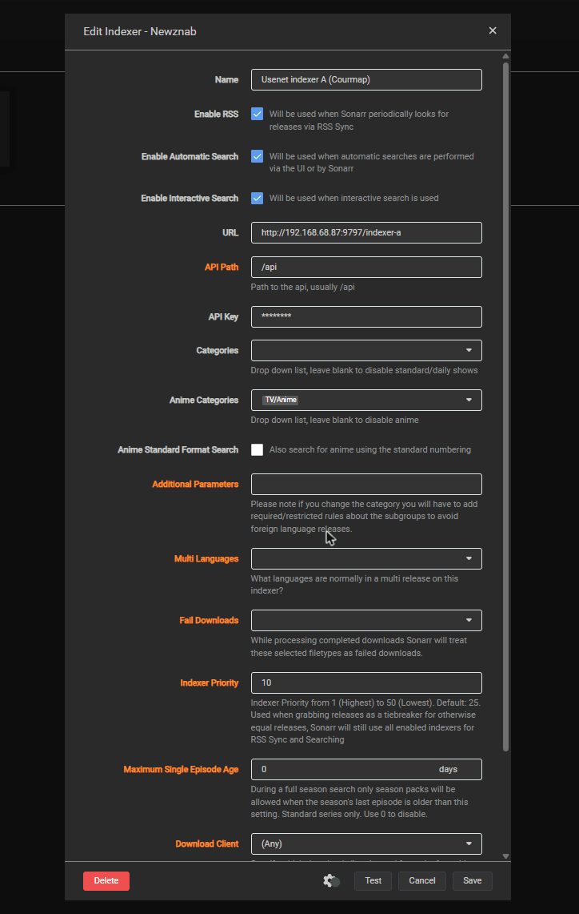
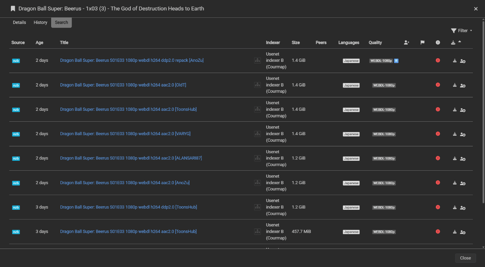
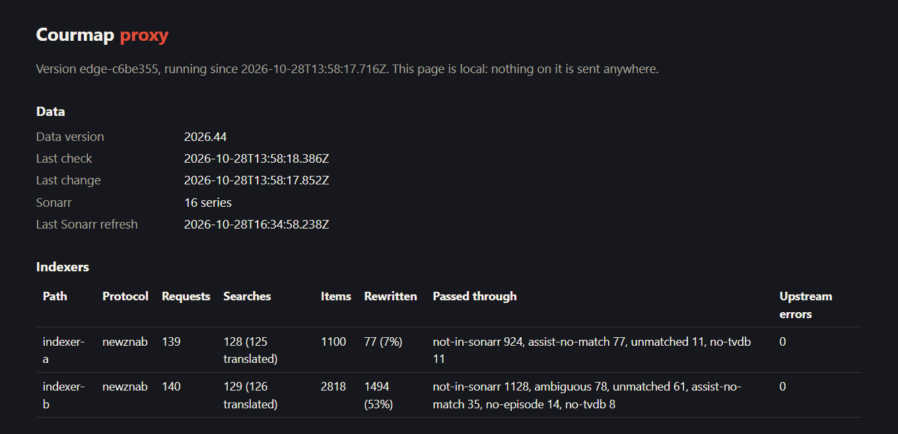

import { Aside, Steps, TabItem, Tabs } from '@astrojs/starlight/components';

Get anime episodes grabbed and imported as the right episode in a few minutes. The proxy sits between Prowlarr and Sonarr and rewrites a release only when it is sure about it. When it is not sure, it passes the release through unchanged, so Sonarr never does worse than it does today.

```text wrap
Sonarr  ->  Courmap proxy  ->  Prowlarr  ->  indexers
```

This page is the short path: Docker Compose, Prowlarr, one torrent indexer and one usenet indexer, both of which also carry regular TV. Unraid, anime-only indexers such as Nyaa, Jackett and a VPN container are in the [full guide](/sonarr/).

## Before you start

You need Docker with Compose, Sonarr v4 and Prowlarr, on the same Docker network. Then collect:

<Steps>

1. **Your Sonarr API key.** In Sonarr, open **Settings**, then **General**. Under **Security**, copy **API Key**. It goes into the proxy.

2. **Your Prowlarr API key.** In Prowlarr, open **Settings**, then **General**. Under **Security**, copy **API Key**. It goes into Sonarr.

3. **The Prowlarr ID of each indexer.** Prowlarr serves every indexer as its own feed at `http://prowlarr:9696/<ID>/api`. In Sonarr, open **Settings**, then **Indexers**, and open an indexer whose name ends in "(Prowlarr)": the number in its **URL** is the ID (`http://prowlarr:9696/1/` means ID `1`). Not listed there? Ask Prowlarr: `curl -s "http://<prowlarr-host>:9696/api/v1/indexer?apikey=<prowlarr-api-key>"` shows each `"id"` next to its `"name"`.

</Steps>

<Aside title="Container names only work on a shared network">
Addresses such as `http://sonarr:8989` and `http://prowlarr:9696` use container names, which Docker resolves only between containers on the same user-defined network. On the default `bridge` network or on different machines, use the host's IP address and published port instead, for example `http://192.168.1.10:8989`.
</Aside>

## 1. Run the proxy

You add one `INDEXER_<NAME>_URL` setting per indexer. `<NAME>` is a label you choose, written in capital letters, digits and underscores. It is **not** the Prowlarr ID. The proxy lowercases it and turns underscores into hyphens, and the result is the path Sonarr will use. The Prowlarr ID goes inside the value. A usenet indexer also takes `INDEXER_<NAME>_TYPE` set to `newznab`; torrent indexers need none.

<div class="stack-table">

| Setting | Value | Address Sonarr uses |
| --- | --- | --- |
| `INDEXER_TRACKER_URL` | `http://prowlarr:9696/1/api` | `http://courmap-proxy:9797/tracker` |
| `INDEXER_GEEK_URL` | `http://prowlarr:9696/2/api` | `http://courmap-proxy:9797/geek` |
| `INDEXER_GEEK_TYPE` | `newznab` | |

</div>

Add this service next to Sonarr and Prowlarr, in the same Compose file so it joins their network:

```yaml wrap
services:
  courmap-proxy:
    image: ghcr.io/courmap/proxy:edge   # the only tag for now
    container_name: courmap-proxy
    restart: unless-stopped
    ports:
      - "9797:9797"                # the status page
    volumes:
      - ./courmap/data:/data       # downloaded data and the list of names it could not resolve
      - ./courmap/config:/config   # optional: a courmap-proxy.yaml with the same settings
    environment:
      SONARR_URL: http://sonarr:8989
      SONARR_API_KEY: your-sonarr-api-key        # Sonarr's key goes here, not Prowlarr's

      # One line per indexer. TRACKER and GEEK are labels you choose; they become /tracker and /geek.
      # The number in the URL is the indexer's ID in Prowlarr.
      INDEXER_TRACKER_URL: http://prowlarr:9696/1/api
      INDEXER_GEEK_URL: http://prowlarr:9696/2/api
      INDEXER_GEEK_TYPE: newznab                 # usenet only
```

Start it with `docker compose up -d courmap-proxy`. `edge` is the only image tag for now; see [image tags](/sonarr/#image-tags) for pinning a build. Open `http://<your-host>:9797/`: within a minute it shows a **Data version** and how many Sonarr series it found.

## 2. Add each proxy path to Sonarr

Torrent and usenet indexers are added as different types, so pick your tab. Choosing the wrong type gives results Sonarr cannot use.

<Aside title="Two different API keys">
The proxy holds your **Sonarr** API key (step 1). Sonarr holds your **Prowlarr** API key, in each indexer below. The proxy passes it on to Prowlarr.
</Aside>

<Tabs syncKey="protocol">
<TabItem label="Torrent (Torznab)">

<Steps>

1. In Sonarr, open **Settings**, then **Indexers**, click **+**, and choose **Torznab** under **Custom**.

2. Fill in:

   - **Name**: `Tracker (Courmap)`
   - **URL**: `http://courmap-proxy:9797/tracker`
   - **API Path**: `/api`
   - **API Key**: your **Prowlarr** API key
   - **Categories**: leave empty
   - **Anime Categories**: `5070`
   - **Indexer Priority**: `10`

   `5070` is the TV/Anime category. Sonarr searches **Anime Categories** for anime series and **Categories** for the rest, so this copy handles anime and Prowlarr's copy keeps regular TV. Priority 10 beats Prowlarr's 25 when both return the same release. [Why, and what to do for an anime-only indexer](/sonarr/#categories-and-indexer-priority).

3. Click **Test**. A green check means Sonarr reached Prowlarr through the proxy. Click **Save**.

</Steps>

</TabItem>
<TabItem label="Usenet (Newznab)">

<Steps>

1. In Sonarr, open **Settings**, then **Indexers**, click **+**, and choose **Newznab** under **Custom**. (The named presets, such as NZBgeek, connect straight to the indexer; Custom lets you point it at the proxy.)

2. Fill in:

   - **Name**: `Geek (Courmap)`
   - **URL**: `http://courmap-proxy:9797/geek`
   - **API Path**: `/api`
   - **API Key**: your **Prowlarr** API key (or the usenet indexer's own key if you proxy it directly)
   - **Categories**: leave empty (clear Sonarr's default 5030 and 5040)
   - **Anime Categories**: `5070`
   - **Indexer Priority**: `10`

   The same rule applies: an empty **Categories** keeps this copy for anime, and Prowlarr's copy keeps regular TV.

3. Click **Test**, then **Save**.

</Steps>

NZB downloads do not go through the proxy: each result's download link still points at the indexer.



*Torznab has the same fields. This install uses bridge networking, so its URL is the server's IP and port; on a shared Docker network, use the container name as above.*

</TabItem>
</Tabs>

## 3. Keep Prowlarr's copies for regular TV

<Aside type="caution" title="Do not skip this step">
Prowlarr adds every indexer to Sonarr itself, as a copy named "Tracker (Prowlarr)". Left alone, that copy and your Courmap copy both return the same anime release: it shows up twice, and the unrewritten one can be grabbed under its original name. The two copies must share the work: Prowlarr's for regular TV, Courmap's for anime.
</Aside>

Leave Prowlarr's Sonarr app on **Full Sync** with no tags, and take anime out of what it sends to Sonarr:

<Steps>

1. In Prowlarr, open **Settings**, then **Apps**, then your **Sonarr** app, and turn on **Show Advanced**.

2. Clear **Anime Sync Categories** (remove `5070`). Leave **Sync Categories** and **Sync Level** (**Full Sync**) as they are, and click **Save**.

3. Back on **Indexers**, click **Sync App Indexers**.

4. In Sonarr, open one of the "(Prowlarr)" copies: its **Anime Categories** is now empty. Do not change categories there yourself, because Prowlarr rewrites them on every sync.

</Steps>

Prowlarr's copy now searches regular series only. Its RSS feed can still return an anime release under its original name, which is why the Courmap copy has the higher priority: when Sonarr has the same release twice, it takes the rewritten one. Have an anime-only indexer such as Nyaa? Clearing the category does not remove its Prowlarr copy; use [the tag method](/sonarr/#anime-only-indexers).

## 4. Check that it works

Open an anime series in Sonarr that has a few episodes out, and click the person icon on an episode's row (**Interactive Search**). Results from your Courmap indexers show rewritten titles, built from the series title in your own Sonarr:

| The indexer's original name | What Sonarr shows |
| --- | --- |
| `[SubsPlease] Spy x Family - 17 (1080p) [ABCD1234].mkv` | `Spy x Family S01E17 (1080p) [ABCD1234] [SubsPlease]` |



A release Courmap was not sure about keeps its original name, so Sonarr treats it exactly as it would without the proxy.

## What success looks like

On the status page (`http://<your-host>:9797/`):



- **Data** shows a data version and your Sonarr series count.
- **Indexers** has one row per path (`geek`, `tracker`) with its **Protocol**, **Requests** counting up as Sonarr's RSS sync runs, **Rewritten** with the share of results renumbered, and **Passed through** with the reasons for the rest.
- A regular (Standard) series adds nothing to the **Requests** of your Courmap indexers in an Interactive Search, and an Anime series does. If a Standard series does, check that **Categories** is empty on the Courmap copy.

## Next

The [full Sonarr guide](/sonarr/) covers [Unraid](/sonarr/#unraid), [a different Compose project](/sonarr/#compose-in-a-different-project), [anime-only indexers](/sonarr/#anime-only-indexers), [Jackett and other feeds](/sonarr/#not-using-prowlarr), [a VPN container such as gluetun](/sonarr/#behind-a-vpn-container), indexer API limits, every setting and troubleshooting.
